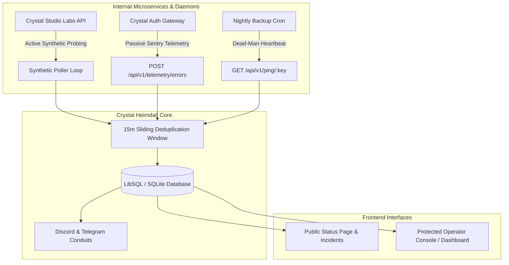

# 🏛️ Crystal Heimdall — Architecture & System Design

> **🔒 CLASSIFICATION: PROPRIETARY & CONFIDENTIAL // FOR INTERNAL USE ONLY**  
> **PROPERTY OF CRYSTAL STUDIO LABS — ALL RIGHTS RESERVED.**  
> *Architectural reference and subsystem topology for Crystal Studio Labs internal engineering.*

---

## 1. System Topology Overview

Crystal Heimdall serves as the central reliability sentinel for all internal microservices, workers, APIs, and batch cron tasks across Crystal Studio Labs.

---

## 2. Core Subsystems

### A. Dual-Engine Observability Matrix
1. **Active Synthetic HTTP/HTTPS Prober:**
   * Periodically checks endpoint availability (configurable 10s–300s).
   * Measures precise DNS, TCP, and TLS round-trip latencies.
   * Compares HTTP status codes against accepted response lists (e.g., `200, 201, 204`).
2. **Inverted "Dead-Man's Snitch" Cron Poller:**
   * For background batch tasks and nightly database backups that cannot be directly queried.
   * Expects pings at specified intervals. Triggers an incident if the heartbeat is overdue.

### B. Passive Crash Sentinel & Telemetry Sink
* Compatible with standard error loggers and Sentry-style clients (`POST /api/v1/telemetry/errors`).
* Automatically extracts stack traces, normalizes error signatures, generates automated fingerprints, and tracks occurrence counts without third-party cloud data leakage.

### C. 15-Minute Sliding Window Deduplication
* Prevents alert storms during cascading service outages.
* Groups recurring failures under an existing incident record within a 15-minute window while silently incrementing event counters.

### E. Native TCP Socket & TLS/SSL Peer Certificate Prober
* Probes raw TCP ports using non-blocking Node.js `net.Socket` connections with strict timeout enforcement.
* Performs deep TLS handshakes via `tls.connect` to inspect remote peer X.509 certificates and calculate actual days remaining to expiry without depending on external SSL APIs.

### F. Dynamic SVG Status Shields & Public RSS Syndicate
* Generates pixel-crisp, Shields.io-compatible Industrial Brutalist SVG status shields directly from server memory (`/api/v1/badges/:id/status.svg`).
* Syndicates public incident updates via standard RSS 2.0 XML (`/status/feed.xml`) for external feed readers, Slack RSS integrations, and enterprise dashboard feeds.

### G. Mobile Sentinel & Lockscreen Audio Pipeline
* Combines PWA Service Worker push notifications (`ServiceWorkerRegistration.showNotification()`), multi-pulse tactile vibration, and continuous looping Web Audio klaxons.
* Uses the W3C `navigator.mediaSession` standard to preserve audio playback priority across mobile lock screens, alongside Screen Wake Lock API (`navigator.wakeLock`) support.

---

## 3. Database Schema (LibSQL / SQLite)

The embedded LibSQL database (`data/heimdall.db`) stores configuration and state in six optimized tables with composite performance indexing:

1. **`services`**: Monitored endpoints, check types (`http-poll`, `port-check`, `deadman-cron`), poll intervals, port numbers, keyword assertions, status (`healthy`, `degraded`, `critical`, `maintenance`), project tags (`group_name`), and isolated API keys.
2. **`incidents`**: Identified outages, severity (`info`, `warning`, `critical`), triage state (`investigating`, `acknowledged`, `resolved`), and resolution timestamps.
3. **`incident_updates`**: Chronological multi-stage operational updates (`investigating`, `identified`, `monitoring`, `resolved`) with composite index `idx_incident_updates_inc_time`.
4. **`telemetry_points`**: Time-series log of all synthetic probes and response times for SLA graphing, backed by composite index `idx_telemetry_svc_time (service_id, recorded_at)`.
5. **`status_settings`**: Configurable branding, announcement banners, SLA toggles, and engine tuning.
6. **`error_issues`**: Passive crash reports with stack traces, environment tags, and triage status.

---

## 4. Industrial Brutalism Design Tokens

The user interface follows strict Industrial Brutalism guidelines:
* **Geometry:** `border-radius: 0px !important` across all buttons, cards, dialogs, inputs, and badges.
* **Palette:**
  * Background: Deep Tactical Void (`#070a0f` / `#08090b`).
  * Surface Panels: Hard Jet Black (`#000000`) and Obsidian (`#0b0f17`).
  * Borders: Heavy 2px–3px Zinc (`#27272a`).
  * Accents: High-voltage Emerald (`#10b981`), Cyber Cyan (`#38bdf8`), and Critical Crimson (`#ef4444`).
* **Shadows:** Hard 3D block shadows (`shadow-[4px_4px_0px_#000]`).
* **Typography:** `JetBrains Mono` and browser monospace for all diagnostic meters, headers, and telemetry logs.
