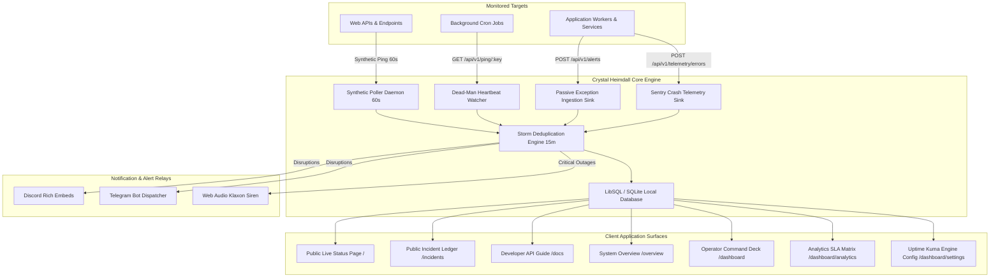

# 🏛️ Crystal Heimdall — System Architecture & Technical Specifications

> **Autonomous Reliability Sentinel, Synthetic Uptime Poller & Crash Ingestion Deck**  
> *Developed by Crystal Studio Labs. Crafted in authentic Industrial Brutalism.*

---

## 1. High-Level System Architecture

Crystal Heimdall is engineered as a unified, zero-bloat reliability sentinel. It operates simultaneously as an **Active Synthetic Poller** (pull-based probing) and a **Passive Telemetry Sink** (push-based crash ingestion), presenting metrics through an **Industrial Brutalism** user interface.



---

## 2. Core Subsystems

### 2.1 Dual-Engine Observability

1. **Active Synthetic Poller (`server/poller.ts`):**
   - Runs on a non-blocking 60-second polling daemon (`runPollCycle()`).
   - Executes round-robin HTTP/HTTPS requests with configurable timeout (default 10s).
   - Validates status codes against acceptable code ranges (`200-299, 301, 302`).
   - Automatically inspects TLS/SSL certificate validity windows and detects expiring certificates.
   - Records discrete latency data points into `telemetry_points` for percentile and histogram analysis.

2. **Dead-Man's Switch (`server/routes/services.ts`):**
   - Monitors scheduled workers, nightly database backups, and cron jobs.
   - Monitored workers check in at `GET /api/v1/ping/:key`.
   - If a heartbeat is overdue by more than `expected_interval + grace_period`, an automatic critical outage incident is tripped.

3. **Inbound Exception Ingestion (`server/routes/alerts.ts`):**
   - Microservices relay uncaught exceptions, promise rejections, and fatal logs via `POST /api/v1/alerts`.
   - Requires Bearer token authentication scoped to the individual service.

4. **Sentry-Style Crash Telemetry (`server/routes/telemetry.ts`):**
   - Passive error ingestion endpoint (`POST /api/v1/telemetry/errors`) accepting structured error payloads with stack traces.
   - Deduplicates identical error signatures (`error_fingerprint`), tracks occurrence counts, and presents an interactive issue inspector on the Operator Dashboard.

---

### 2.2 Alert Storm Deduplication (`server/deduplicator.ts`)

During cascading infrastructure outages, dozens of downstream workers might trigger simultaneous alert dispatches. Heimdall implements a sliding 15-minute in-memory and database deduplication cache:
- Errors with matching `(service_id, title)` within 15 minutes are suppressed from duplicate notification relays.
- The occurrence counter is incremented (`× 42 occurrences`).
- Dispatches are resumed only after cooldown expiry or state transitions.

---

### 2.3 Progressive Web App (PWA) & Web Audio Klaxon Siren

- **Offline Caching:** Handled by `client/public/sw.js` with stale-while-revalidate strategy.
- **Auditory Alert Engine (`client/src/lib/audioAlerts.ts`):**
  - Synthesized via the native browser **Web Audio API** (no external audio assets required).
  - Uses dual square/sawtooth oscillators modulating between 660 Hz and 880 Hz with exponential gain envelopes to produce an authentic high-urgency industrial alarm.
  - Armed/Muted toggle persists in local storage and executes instant audible sirens on P0 downtime events.

---

## 3. Database Schema (LibSQL / SQLite)

The database schema is managed via LibSQL (`server/db.ts`), supporting local SQLite files (`data/heimdall.db`) and remote Turso edges:

```sql
-- Monitored Targets
CREATE TABLE services (
  id TEXT PRIMARY KEY,
  name TEXT NOT NULL,
  type TEXT NOT NULL,             -- 'http-poll', 'deadman-cron', 'passive-sink'
  endpoint TEXT,
  expected_interval_sec INTEGER,
  status TEXT DEFAULT 'healthy',  -- 'healthy', 'warning', 'critical', 'maintenance'
  latency_ms INTEGER,
  uptime_pct REAL DEFAULT 100.0,
  is_public INTEGER DEFAULT 1,
  is_maintenance INTEGER DEFAULT 0,
  api_key TEXT UNIQUE,
  last_ping_at INTEGER,
  consecutive_failures INTEGER DEFAULT 0,
  created_at INTEGER
);

-- Historical Incidents Ledger
CREATE TABLE incidents (
  id TEXT PRIMARY KEY,
  service_id TEXT,
  title TEXT NOT NULL,
  message TEXT,
  severity TEXT NOT NULL,         -- 'critical', 'warning', 'info'
  status TEXT DEFAULT 'active',   -- 'active', 'acknowledged', 'resolved'
  count INTEGER DEFAULT 1,
  created_at INTEGER,
  last_seen_at INTEGER,
  resolved_at INTEGER
);

-- Real-Time Latency Telemetry Points
CREATE TABLE telemetry_points (
  id TEXT PRIMARY KEY,
  service_id TEXT,
  latency_ms INTEGER,
  status_code INTEGER,
  recorded_at INTEGER
);

-- Sentry Crash Issues
CREATE TABLE sentry_errors (
  id TEXT PRIMARY KEY,
  fingerprint TEXT UNIQUE,
  title TEXT NOT NULL,
  message TEXT,
  stack_trace TEXT,
  severity TEXT DEFAULT 'error',
  status TEXT DEFAULT 'unresolved',
  count INTEGER DEFAULT 1,
  first_seen_at INTEGER,
  last_seen_at INTEGER,
  resolved_at INTEGER
);

-- Uptime Kuma Status Page & Engine Settings
CREATE TABLE status_settings (
  key TEXT PRIMARY KEY,
  value TEXT
);
```

---

## 4. Design System: Industrial Brutalism

Crystal Heimdall strictly adheres to the **Industrial Brutalism** design philosophy:
1. **Zero Curvature:** `border-radius: 0px !important` across all containers, inputs, badges, and modals.
2. **Deep Monolithic Palette:** Base canvas `#070a0f`, surface cards `#0b0f17`, borders `#27272a`.
3. **Hard 3D Block Shadows:** Tactile `shadow-[4px_4px_0px_#000]` offset shadows with mechanical button press translations (`active:translate-x-[1px] active:translate-y-[1px]`).
4. **Monospace Dominance:** JetBrains Mono for diagnostic meters, SLA percentages, and data headers; Inter for long-form explanatory reading.
5. **Color Semantics:**
   - Emerald (`#10b981`): Healthy, Nominal, Resolved.
   - Cyan (`#06b6d4`): Poller Telemetry, Metrics, Inbound Hooks.
   - Amber (`#f59e0b`): Warning, Partial Degradation, Dead-Man Tracking.
   - Rose (`#f43f5e`): Outage, Critical Disruption, Siren Alert.
