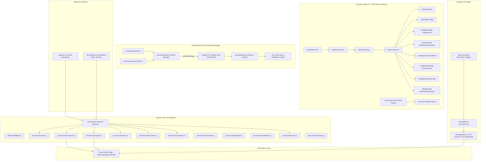

# 🔄 Crystal-Heimdall: Code Execution Flow & Architecture Map

> **Repository:** Crystal-Heimdall (`v2.0.0`)  
> **Status:** Active Architectural Reference  
> **Document Purpose:** Maps how control, data, and execution move across files, runtime boundaries, network interfaces, and mobile devices.

---

## 🗺️ High-Level System Architecture

---

## 🧭 Subsystem Execution Flow

### 1. Inbound Synthetic Health Probing Loop
1. **Trigger:** `server/poller.ts` executes every 30s–60s (or via `/api/v1/cron/poll` on Vercel).
2. **Dispatch:** Inspects `services` table for targets requiring evaluation.
3. **Execution:**
   * HTTP/HTTPS: Dispatches non-blocking `fetch()` with timeout and keyword assertion check.
   * Raw TCP: Opens `net.Socket` to port (e.g. `6543`), calculates connection latency, and cleanly destroys socket.
   * TLS Inspection: Reads `getPeerCertificate()` to compute days remaining until SSL expiry.
4. **State Transition:** If consecutive failures exceed threshold, opens incident and invokes `notifySubscribers()`.

### 2. Closed-Browser W3C Web Push Notification Flow
1. **Subscription Arming:** Client opens `SubscribeModal.tsx` ➔ requests browser push permission ➔ retrieves VAPID public key via `GET /api/v1/push/vapid-public-key`.
2. **Registration:** Browser generates cryptographic device token (`p256dh` and `auth`) ➔ registers via `POST /api/v1/push/subscribe`.
3. **Dispatch:** Incident occurs ➔ `server/subscribers.ts` invokes `server/webpush.ts` `sendPushNotification()`.
4. **Wakeup:** Google FCM / Apple APNs pushes payload to device ➔ `client/public/sw.js` `push` event fires in background ➔ renders system lockscreen notification with multi-pulse vibration.

### 3. Operator 2FA Verification Flow
1. **Challenge:** Operator visits `/login`, enters 6-digit rolling code from authenticator app.
2. **Verification:** `server/routes/auth.ts` verifies TOTP using `speakeasy.totp.verify()` with window ±1.
3. **Session Issuance:** If valid, generates signed HMAC-SHA256 JWT token with 24-hour expiration.
4. **Client Storage:** Client persists token in `localStorage`, unlocks privileged console routes (`Navbar.tsx` & `MobileBottomNav.tsx`).

### 4. GitHub Pages Showcase Streaming Flow
1. **Visitor:** Opens `https://crystal-studio-labs.github.io/Crystal-Heimdall/`.
2. **Live Telemetry Stream:** In-browser script polls `https://crystal-heimdall.vercel.app/api/v1/status`.
3. **Fallback Resiliency:** If connection is delayed or restricted, immediately falls back to high-density cached demonstration monitors.
4. **Interactive Controls:** Visitor can test Web Audio Klaxon siren, open simulated Command Palette (`Ctrl+K`), or copy SDK integration code in 6 runtimes.
