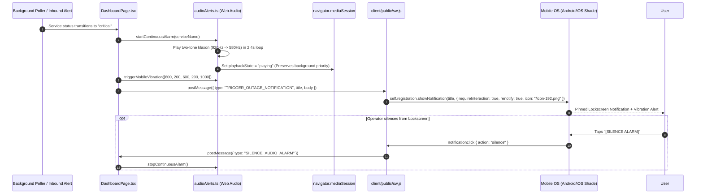
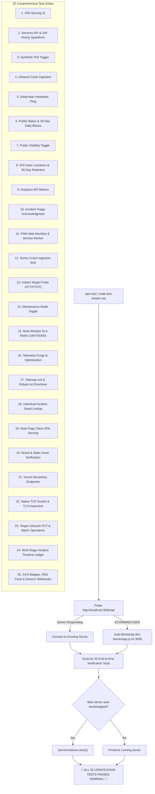

# 🔄 Crystal-Heimdall: Code Execution Flow & Architecture Map

> **Repository:** Crystal-Heimdall (`v2.0.0`)  
> **Status:** Active Architectural Reference  
> **Document Purpose:** Maps how control, data, and execution move across files, runtime boundaries, network interfaces, and mobile devices.

---

## 🗺️ High-Level System Architecture

```mermaid
flowchart TD
    subgraph Client_Layer [Frontend: React 18 + Vite SPA]
        IndexHTML["client/index.html"] --> MainTSX["client/src/main.tsx"]
        MainTSX --> AppTSX["client/src/App.tsx"]
        AppTSX --> Router["React Router v6"]
        Router --> StatusPage["StatusPage (/)"]
        Router --> LoginPage["LoginPage (/login)"]
        Router --> Dashboard["DashboardPage (/dashboard)"]
        Router --> Analytics["AnalyticsPage (/analytics)"]
        Router --> Incidents["IncidentsPage (/incidents)"]
        Router --> IncidentDetail["IncidentDetailPage (/incidents/:id)"]
        Router --> Overview["LandingPage (/overview)"]
        Router --> DocsPage["DocsPage (/docs)"]
        Router --> Settings["SettingsPage (/dashboard/settings)"]
    end

    subgraph Mobile_Sentinel [Mobile OS & PWA Layer]
        SW["client/public/sw.js (Service Worker)"]
        Audio["client/src/lib/audioAlerts.ts (Web Audio Klaxon)"]
        MediaSession["navigator.mediaSession (Audio Priority)"]
        WakeLock["navigator.wakeLock (Screen Awake)"]
        SysTray["Android / iOS Notification Tray & Lockscreen"]
    end

    subgraph Entrypoints [Backend Runtimes]
        VercelReq["api/index.js (Vercel Serverless)"]
        NodeReq["server/index.ts (Standalone Node / Docker)"]
    end

    subgraph Core_Server [Express Core: server/app.ts]
        App["server/app.ts (Express Instance)"]
        ColdStart["initDb() Middleware"]
        AuthRoutes["server/routes/auth.ts"]
        ServicesRoutes["server/routes/services.ts"]
        StatusRoutes["server/routes/status.ts"]
        AlertsRoutes["server/routes/alerts.ts"]
        IncidentsRoutes["server/routes/incidents.ts"]
        AnalyticsRoutes["server/routes/analytics.ts"]
        ChannelsRoutes["server/routes/channels.ts"]
        BadgesRoutes["server/routes/badges.ts"]
        TelemetryRoutes["server/routes/telemetry.ts"]
        RSSFeed["/status/feed.xml (RSS 2.0 Syndicate)"]
        StaticServe["dist-client SPA Serving"]
    end

    subgraph Background_Workers [Daemons & Probers]
        Poller["server/poller.ts (runPollCycle)"]
        Probers["server/probers.ts (TCP Socket & TLS Handshake)"]
        CronTrigger["/api/v1/cron/poll (External / Synthetic)"]
        Interval["setInterval (60s loop)"]
    end

    subgraph Database_Layer [LibSQL / SQLite]
        DB["server/db.ts (initDb / getDb)"]
        DiskDB[("data/heimdall.db or /tmp/heimdall.db")]
    end

    NodeReq -->|boots| App
    VercelReq -->|exports handler| App
    App --> ColdStart --> DB --> DiskDB
    App --> AuthRoutes
    App --> ServicesRoutes
    App --> StatusRoutes
    App --> AlertsRoutes
    App --> IncidentsRoutes
    App --> AnalyticsRoutes
    App --> ChannelsRoutes
    App --> BadgesRoutes
    App --> TelemetryRoutes
    App --> RSSFeed
    App --> StaticServe

    NodeReq --> Interval --> Poller
    CronTrigger --> Poller
    Poller --> Probers
    Poller --> DB
    Client_Layer -->|Fetch API| Core_Server
    Dashboard --> Audio
    Audio --> MediaSession
    Audio --> WakeLock
    Dashboard --> SW --> SysTray
```



---

## 1. Server Bootstrap & Dual-Mode Hosting Flow

Crystal-Heimdall supports two distinct backend operational runtimes:

### A. Standalone Node / Docker Flow
```text
server/index.ts
  │
  ├── 1. Loads environment variables (dotenv.config())
  ├── 2. Calls initDb() from server/db.ts
  │       ├── Resolves database file path (data/heimdall.db)
  │       ├── Executes DDL schema migrations (services, incidents, incident_updates, telemetry_points)
  │       └── Creates performance composite indexes: idx_telemetry_svc_time, idx_incident_updates_inc_time
  ├── 3. Binds HTTP socket on PORT (default: 3030)
  │       ├── Serves API endpoints from server/routes/*
  │       ├── Serves dynamic SVG badges (/api/v1/badges/:id/status.svg)
  │       ├── Serves public incident RSS feed (/status/feed.xml)
  │       └── Serves static client bundle from dist-client/
  ├── 4. Launches background polling daemon: setInterval(runPollCycle, 60_000)
  └── 5. Triggers immediate initial boot probe cycle after 2 seconds
```

### B. Vercel Serverless Flow
```text
HTTP Request to /api/*
  │
  ├── 1. Intercepted by api/index.js
  ├── 2. Imports decoupled app from server/app.ts (no socket listen)
  ├── 3. Cold-start middleware in server/app.ts invokes initDb()
  │       ├── Detects process.env.VERCEL
  │       └── Resolves path to /tmp/heimdall.db (ephemeral read-write fallback)
  └── 4. Express router resolves request and responds directly
```

---

## 2. Client SPA Execution & Routing Flow

```mermaid
sequenceDiagram
    autonumber
    actor User as Browser / Operator
    participant HTML as client/index.html
    participant Main as client/src/main.tsx
    participant App as client/src/App.tsx
    participant Router as React Router
    participant API as /api/v1/*

    User->>HTML: Navigates to domain
    HTML->>Main: Loads bundle & Tailwind styles
    Main->>App: Mounts React Virtual DOM
    App->>Router: Evaluates window.location.pathname
    alt Path is /
        Router->>StatusPage: Render public uptime & SLA
        StatusPage->>API: GET /api/v1/status (is_public=1 only)
        API-->>StatusPage: Fleet health, public incidents & services (authentic 30-day SQL blocks)
        opt Operator Authenticated (Session Valid >= 7 days)
            StatusPage->>StatusPage: Display [OPERATOR DECK] button in header & footer
            User->>StatusPage: Clicks [OPERATOR DECK] -> navigates directly to /dashboard
        end
    alt Path is /login
        opt Session Already Active
            LoginPage->>Router: Auto-redirects to /dashboard (no TOTP re-prompt)
        end
        Router->>LoginPage: Render 2FA TOTP input (if unauthenticated or ?reauth=true)
        User->>LoginPage: Submits 6-digit TOTP code
        LoginPage->>API: POST /api/v1/auth/login { code }
        API-->>LoginPage: JWT Token { token, expiresInDays: 30 } -> stored in localStorage
        LoginPage->>Router: Redirect to /dashboard
    alt Path is /dashboard
        Router->>DashboardPage: Validate session token via ProtectedRoute
        DashboardPage->>API: GET /api/v1/services (Bearer token)
        API-->>DashboardPage: Full operator service fleet (with project groups & sparklines)
    end
```

---

## 3. Synthetic Poller, Health Probing & Incident Flow

The poller (`server/poller.ts`) leverages modular probers (`server/probers.ts`) to evaluate endpoints:

```mermaid
sequenceDiagram
    autonumber
    participant Timer as Poller Daemon / Cron Trigger
    participant Poller as server/poller.ts
    participant Probers as server/probers.ts
    participant Target as External Monitored Target
    participant DB as server/db.ts
    participant Alerts as server/dispatcher.ts
    participant Webhook as Telegram / Discord / Generic Webhooks

    Timer->>Poller: runPollCycle()
    Poller->>DB: Query active services (paused = 0, is_maintenance = 0)
    loop For each service
        alt Type: HTTP / HTTPS
            Poller->>Target: HTTP GET / HEAD with timeout
            Target-->>Poller: Response status, headers & latency
            opt Check SSL Expiry
                Poller->>Probers: inspectTlsCertificate(hostname, port)
                Probers-->>Poller: Certificate days remaining & issuer
            end
            opt Keyword Assertion
                Poller->>Target: Response text must contain keyword
            end
        alt Type: TCP Socket Port
            Poller->>Probers: probeTcpPort(host, port, timeoutMs)
            Probers->>Target: net.Socket connect
            Target-->>Probers: TCP connection established
            Probers-->>Poller: Round-trip latency (ms)
        alt Type: Dead-Man's Switch
            Poller->>DB: Check (now - last_ping_at) > ping_interval
        end

        alt Health Check Passed
            Poller->>DB: Record latency snapshot in telemetry_points
            Poller->>DB: UPDATE services SET status = 'healthy', consecutive_failures = 0
            opt Previous Active Incident Exists
                Poller->>DB: Auto-resolve incident (status = 'resolved')
                Poller->>DB: INSERT INTO incident_updates ('resolved', 'Automatic recovery')
                Poller->>Alerts: Dispatch resolution notification
            end
        else Health Check Failed
            Poller->>DB: INCREMENT consecutive_failures
            alt consecutive_failures >= retry_count
                Poller->>DB: UPDATE services SET status = 'critical'
                Poller->>DB: INSERT INTO incidents (service_id, title, status = 'active')
                Poller->>DB: INSERT INTO incident_updates ('investigating', initial_message)
                Poller->>Alerts: dispatchWebhookAlert()
                Alerts->>Webhook: POST JSON notification payload (Discord/Telegram/Slack/n8n)
            end
        end
    end
```

---

## 4. Mobile Sentinel & Lockscreen Alarm Pipeline

Ensures on-call operators are awoken even when mobile phones are locked:



---

## 5. Target Lifecycle & Batch Operations Flow

Operators manage synthetic monitors with full agile operational control:

```text
Dashboard Operator Deck
  │
  ├── In-Place Edit (PUT /api/v1/services/:id)
  │     ├── Modifies: name, endpoint, port, interval, retries, keyword, status codes, group tag
  │     ├── If HTTPS endpoint: Automatically runs inspectTlsCertificate() to update SSL ledger
  │     └── Emits live update to connected clients
  │
  └── Batch Fleet Operations (POST /api/v1/services/batch)
        ├── pause-all: Sets is_maintenance = 1 across target IDs
        ├── resume-all: Sets is_maintenance = 0 across target IDs
        ├── set-group: Assigns project tag (Campus Relay, KrishiSetu, OSCC, Production)
        └── delete-selected: Atomically deletes targets and cascaded telemetry
```

---

## 6. Dynamic Badges, RSS Syndicate & Webhook Dispatch

```text
External Consumers & Readers
  │
  ├── Dynamic SVG Status Badges (/api/v1/badges/:id/status.svg)
  │     ├── Params: ?metric=status | uptime | latency & ?label=Custom
  │     ├── Resolves fleet health (:id === 'fleet') or individual target
  │     └── Returns Shields.io-compatible Industrial Brutalist flat SVG (Content-Type: image/svg+xml)
  │
  ├── Public Incident RSS Feed (/status/feed.xml)
  │     ├── Intercepted before SPA client wildcard fallback
  │     ├── Formats all incidents into valid RSS 2.0 XML
  │     └── Subscribed by Slack RSS integrations, feed readers, and external monitoring hubs
  │
  └── Universal Generic Webhook Relay (server/dispatcher.ts)
        ├── Dual-format JSON payload with standard fields (service, severity, message, timestamp)
        ├── Top-level "text" and "mrkdwn" attributes for direct Slack/Mattermost compatibility
        └── Dispatches to Slack, n8n, Zapier, PagerDuty, or custom webhook endpoints
```

---

## 7. Test Runner Execution Flow (`test-smoke.mjs`)


