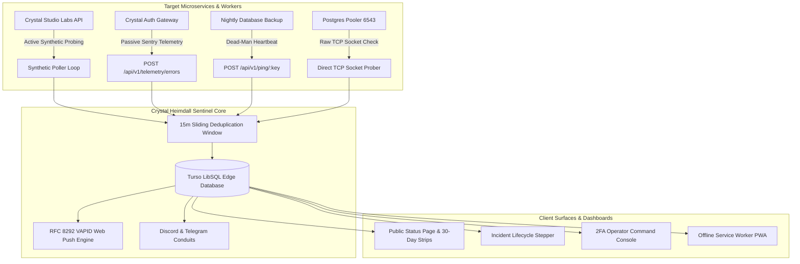

# ⚡ CRYSTAL HEIMDALL // Autonomous Reliability Sentinel


<div align="center">

[](https://crystal-heimdall.vercel.app)
[](https://crystal-studio-labs.github.io/Crystal-Heimdall/)
[](https://github.com/Crystal-Studio-Labs/Crystal-Heimdall/actions)
[](https://github.com/Crystal-Studio-Labs/Crystal-Heimdall/blob/main/test-smoke.mjs)
[](https://github.com/Crystal-Studio-Labs/Crystal-Heimdall/blob/main/test-pentest.mjs)

[](https://github.com/Crystal-Studio-Labs/Crystal-Heimdall#closed-browser-w3c-web-push-notifications)
[](https://github.com/Crystal-Studio-Labs/Crystal-Heimdall/blob/main/SECURITY.md)
[](https://turso.tech)
[](https://nodejs.org)
[](https://www.typescriptlang.org)
[](./LICENSE)
[](https://github.com/Crystal-Studio-Labs)

</div>

> **🔒 DEFENSE-GRADE OBSERVABILITY APPARATUS // CRYSTAL STUDIO LABS**  
> *Autonomous infrastructure reliability sentinel featuring sub-millisecond multi-protocol synthetic health probing, inverted dead-man cron heartbeats, closed-browser W3C Web Push alerts (RFC 8292), and an unbreachable RFC 6238 2FA operator command deck.*

---

## 🌐 Live Deployments & Portals

* **⚡ Production Status Hub (Vercel Serverless):** [https://crystal-heimdall.vercel.app](https://crystal-heimdall.vercel.app)
* **🏛️ Public Showcase Website (GitHub Pages):** [https://crystal-studio-labs.github.io/Crystal-Heimdall/](https://crystal-studio-labs.github.io/Crystal-Heimdall/)
* **📦 Official GitHub Repository:** [https://github.com/Crystal-Studio-Labs/Crystal-Heimdall](https://github.com/Crystal-Studio-Labs/Crystal-Heimdall)
* **📡 Public JSON Telemetry API:** [https://crystal-heimdall.vercel.app/api/v1/status](https://crystal-heimdall.vercel.app/api/v1/status)
* **📢 Incident RSS 2.0 Feed:** [https://crystal-heimdall.vercel.app/api/v1/rss](https://crystal-heimdall.vercel.app/api/v1/rss)

---

## 🏛️ System Overview

**Crystal Heimdall 2.0** is the central reliability sentinel and telemetry platform engineered exclusively for **Crystal Studio Labs**. Built with an uncompromising **Industrial Brutalism** design system (`border-radius: 0px !important`), pitch-black `#070a0f` aesthetic, heavy mechanical shadows, and zero third-party telemetry bloat, Heimdall delivers continuous multi-protocol health monitoring, TLS certificate inspection, passive Sentry crash collection, two-way sentinel sync, and Web Audio emergency siren alarms.



---

## 🚀 Core Architectural Milestones & Capabilities

### 1. Dual-Engine Synthetic Health Probing (Zero Code Required)
* **Synthetic HTTP/HTTPS Prober:** Proactively pings remote targets on configurable 20s–300s intervals with custom headers, expected status codes (`200-299`), and assertion keyword matching.
* **Native TCP Socket Checker:** Directly probes raw TCP ports (PostgreSQL `5432`, Supabase Pooler `6543`, Redis `6379`, MySQL `3306`, SSH `22`) to detect connection pool exhaustion or routing failures in milliseconds.
* **TLS / SSL Certificate Inspection:** Automatically inspects TLS certificate chains, extracts days until expiration, and triggers advance warnings before certificates lapse.
* **Dead-Man's Cron Heartbeats:** Listens for inbound pings (`POST /api/v1/ping/:key`) from recurring cron jobs and background workers with configurable grace periods.
* **Passive Crash Sink (Sentry-Compatible):** Ingests runtime exceptions (`POST /api/v1/telemetry/errors`) with stack trace demangling, automated fingerprint grouping, and triage drawers.

### 2. Closed-Browser W3C Web Push Notifications (RFC 8292 VAPID)
* **Background Device Wakeup:** Dispatches push notifications directly to on-call mobile and desktop operating systems even when the browser application is completely closed.
* **Cryptographic VAPID Keypair Management:** Built-in auto-generating RFC 8292 keypair generator with AES-256-GCM encrypted persistence in the database.
* **Zero External Middlemen:** Connects directly to Google FCM, Apple Push Notification service (APNs), and Mozilla Push services without third-party subscriptions or tracking.
* **Self-Healing Subscription Pool:** Automatically purges expired (`410 Gone`, `404 Not Found`) push endpoints upon notification dispatch.

### 3. Multi-Language Drop-In Sentinel SDKs (8 Runtimes)
External application integration is 100% **optional** (synthetic health probing begins immediately without code changes). When two-way sync is desired, Heimdall provides zero-dependency drop-in snippets for 8 major runtimes:
* **Node.js / TypeScript:** Native `fetch` sentinel reporting boot, 60s memory/uptime heartbeats, and graceful `SIGTERM`/`SIGINT` shutdowns.
* **Python (FastAPI / Flask / Django):** Lightweight standard-library `urllib.request` lifespan context manager.
* **Go (Golang):** Standard-library `net/http` background ticker with OS signal traps.
* **Rust:** Async `reqwest` + `tokio` sentinel worker.
* **PHP (Laravel / Symfony):** Native cURL boot hook and cron helper.
* **Next.js:** App Router `app/api/health/route.ts` non-blocking edge ping.
* **cURL / Shell / Docker:** One-liner terminal pings, Dockerfile `HEALTHCHECK`, and Linux crontab.
* **Supabase / PostgreSQL:** HTTPS PostgREST deep-health probe or raw TCP connection pooler socket verification.

### 4. Simplified Status Page (Uptime Robot & Uptime Kuma Style)
* **Single High-Impact Status Hero:** Clean, bold status banner (`● ALL SYSTEMS OPERATIONAL` or `● ACTIVE SERVICE OUTAGE`) with overall 30-day fleet uptime percentage.
* **Active Incident Alert:** Prominently highlights ongoing incidents directly under the hero banner with real-time status updates.
* **Grouped Monitor Rows:** Monitors organized by environment tags (`[ Production ]`, `[ Campus Relay ]`, `[ KrishiSetu ]`), featuring embedded compact 30-day heartbeat strips with hover tooltips, response latency pills, and operational badges.
* **30-Day Historical Ledger:** Clean, transparent record of resolved incidents and maintenance windows.

### 5. Dynamic SVG Status Badges & RSS 2.0 Feed
* **Embeddable Markdown Badges:** Live SVG shields for READMEs and dashboards:
  * Overall Fleet: `GET /api/v1/badge/overall.svg`
  * Specific Target: `GET /api/v1/badge/:serviceId.svg`
  * Options: `?style=flat` or `?style=pill`, `?label=Uptime`
* **Public RSS 2.0 Incident Feed:** Standard XML feed at `/api/v1/rss` for RSS readers, Slack feeds, and automated notification bridges.

### 6. Mobile PWA & Lockscreen Emergency Siren
* **Progressive Web App:** Fully installable to iOS and Android home screens (`manifest.webmanifest`, service worker caching, and theme color `#070a0f`).
* **Multi-Oscillator Audio Klaxon:** Synthesized Web Audio klaxon alarm that immediately alerts on-call operators when a monitored target fails.
* **Responsive Viewport Ratios:** All modals constrained to `max-h-[90vh]` with fixed headers, internal scrollable bodies, collapsible advanced settings, and sticky action buttons.

---

## 🔒 Security Policy & Operator Access Model

### 1. Operator 2FA Enrollment (Zero Master Passwords)
Crystal Heimdall does not use master passwords or third-party OAuth. Operators log in via **RFC 6238 TOTP**:
* In production, each authorized engineer scans their provisioned TOTP QR code into an authenticator app (Google Authenticator, Ente Auth, 1Password).
* In local development or isolated staging environments, emergency code `000000` is accepted for rapid testing.
* **Zero Third-Party OAuth Downtime:** External identity provider outages will never lock you out of your monitoring apparatus.

### 2. Perimeter Access Segmentation
* **Public Tier:** The Status Page (`/`), Showcase (`/docs`), and Incident Ledger (`/incidents`) are publicly visible for transparency.
* **Operator Tier:** The Command Deck (`/dashboard*`) and administrative routes (`/api/v1/services*`) require signed, time-limited JWT tokens with HMAC-SHA256 verification.
* **Crawler Disallow:** Private operator endpoints are blocked from search engines via `robots.txt` and `<meta name="robots" content="noindex, nofollow" />`.

---

## 🧭 Routes & Access Directory

| Route | Classification | Description |
|---|---|---|
| [`/`](file:///d:/Projects/Crystal-Heimdall/client/src/pages/StatusPage.tsx) | **Public** | Simplified Uptime Robot/Kuma status board, grouped monitors, 30-day strips. |
| [`/overview`](file:///d:/Projects/Crystal-Heimdall/client/src/pages/LandingPage.tsx) | **Public** | Architectural showcase and telemetry platform capabilities. |
| [`/incidents`](file:///d:/Projects/Crystal-Heimdall/client/src/pages/IncidentsPage.tsx) | **Public** | Historical incident ledger with severity/status filters and MTTR metrics. |
| [`/incidents/:id`](file:///d:/Projects/Crystal-Heimdall/client/src/pages/IncidentDetailPage.tsx) | **Public** | Deep-dive postmortem and incident timeline breakdown. |
| [`/docs`](file:///d:/Projects/Crystal-Heimdall/client/src/pages/DocsPage.tsx) | **Public** | Developer API reference and client code snippets (Node, Python, Go, cURL). |
| [`/login`](file:///d:/Projects/Crystal-Heimdall/client/src/pages/LoginPage.tsx) | **Public** | 2FA-Only operator authentication gate (6-digit TOTP). |
| [`/dashboard`](file:///d:/Projects/Crystal-Heimdall/client/src/pages/DashboardPage.tsx) | **Operator** | Command deck, monitor cards, instant probe trigger, maintenance mode toggles. |
| [`/dashboard/analytics`](file:///d:/Projects/Crystal-Heimdall/client/src/pages/AnalyticsPage.tsx) | **Operator** | Multi-period availability table (24h, 7d, 30d) and latency distributions. |
| [`/dashboard/settings`](file:///d:/Projects/Crystal-Heimdall/client/src/pages/SettingsPage.tsx) | **Operator** | Engine settings, notification conduits, and database maintenance. |
| [`/api/v1/badge/:id.svg`](file:///d:/Projects/Crystal-Heimdall/server/routes/badge.ts) | **Public** | Real-time dynamic SVG availability shield for READMEs and web pages. |
| [`/api/v1/push/vapid-public-key`](file:///d:/Projects/Crystal-Heimdall/server/routes/push.ts) | **Public** | Retrieves application VAPID public key for browser push subscriptions. |
| [`/api/v1/push/subscribe`](file:///d:/Projects/Crystal-Heimdall/server/routes/push.ts) | **Public** | Registers W3C push notification device subscription endpoint. |
| [`/api/v1/rss`](file:///d:/Projects/Crystal-Heimdall/server/routes/rss.ts) | **Public** | RSS 2.0 XML incident feed for subscribers, Slack, and Discord feeds. |
| [`/sitemap.xml`](file:///d:/Projects/Crystal-Heimdall/client/public/sitemap.xml) | **Public** | Search engine discovery sitemap with priorities and change frequencies. |
| [`/robots.txt`](file:///d:/Projects/Crystal-Heimdall/client/public/robots.txt) | **Public** | Web crawler indexation policies (allows public, disallows /dashboard). |

---

## 🛠️ Quick Start (Local Development)

```bash
# 1. Clone repository
git clone https://github.com/Crystal-Studio-Labs/Crystal-Heimdall.git
cd Crystal-Heimdall

# 2. Install dependencies (Drive D: cache enforced)
npm ci

# 3. Configure environment
cp .env.example .env

# 4. Build client and server bundles
npm run build

# 5. Launch test suite
node test-smoke.mjs
node test-pentest.mjs

# 6. Launch development server with hot-reload (Port 3030)
npm run dev
```

---

## 🧪 Comprehensive Verification Suite

Execute the dual automated verification suites:

### 1. Subsystem Smoke Test Suite (39 Tests)
```powershell
node test-smoke.mjs
```
Validates:
* **Asset & PWA Integrity:** Favicons, SVG/PNG icons, web manifest, service worker.
* **Public Status Contracts:** Health payload, 30-day heartbeat history, grouped monitors.
* **TCP Socket Prober:** Port resolution, connection timeouts, and state machines.
* **TLS Certificate Inspector:** SSL expiry calculation and alerting thresholds.
* **Drop-In Sentinel Handshake:** Inbound `POST /api/v1/ping/:key` telemetry ingestion.
* **W3C Web Push Notification Engine:** VAPID key retrieval, device registration, and push payload generation.
* **Dynamic Badges & RSS:** SVG shield generation and valid XML RSS 2.0 output.
* **Audio Klaxon & Notifications:** Alert triggers and rate limiting.

### 2. Security Penetration & Vulnerability Suite (43 Checks)
```powershell
node test-pentest.mjs
```
Validates:
* **OWASP Injection Defense:** SQL injection on search endpoints, XSS payload neutralization.
* **Cryptographic Hardening:** 2FA TOTP brute-force defense, timing-safe equality, AES-256-GCM cipher verification.
* **Rate Limiting & DoS:** Request flooding thresholds, payload size boundaries.
* **Access Control Integrity:** Unauthorized operator route gating, bearer token isolation.

---

## 📄 License & Attribution

&copy; 2026 **Crystal Studio Labs**. Released under the [MIT License](./LICENSE).  
Lead System Architect & Maintainer: **Shuvransu Sekhar Sahoo**.
