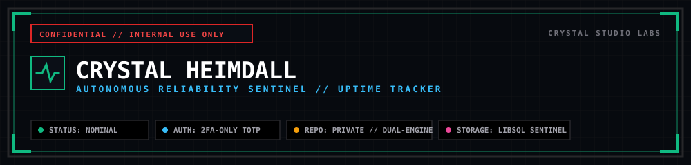

# ⚡ CRYSTAL HEIMDALL // Autonomous Reliability Sentinel



> **🔒 CLASSIFICATION: PROPRIETARY & CONFIDENTIAL // FOR INTERNAL USE ONLY**  
> **PROPERTY OF CRYSTAL STUDIO LABS — ALL RIGHTS RESERVED.**  
> *Unauthorized copying, distribution, cloning, public deployment, or reverse engineering of this software is strictly prohibited.*

---

## 🏛️ System Overview

**Crystal Heimdall** is the dedicated, private reliability sentinel and infrastructure monitoring platform engineered exclusively for **Crystal Studio Labs**. Built with an **Industrial Brutalism** design system (`border-radius: 0px !important`), high-density monospace telemetry meters, and zero third-party telemetry bloat, Heimdall delivers continuous multi-protocol health monitoring, TLS certificate inspection, passive Sentry crash collection, two-way sentinel sync, and Web Audio emergency siren alarms.

---

## 🚀 Core Architectural Milestones & Capabilities

### 1. Dual-Engine Synthetic Health Probing (Zero Code Required)
* **Synthetic HTTP/HTTPS Prober:** Proactively pings remote targets on configurable 20s–300s intervals with custom headers, expected status codes (`200-299`), and assertion keyword matching.
* **Native TCP Socket Checker:** Directly probes raw TCP ports (PostgreSQL `5432`, Supabase Pooler `6543`, Redis `6379`, MySQL `3306`, SSH `22`) to detect connection pool exhaustion or routing failures in milliseconds.
* **TLS / SSL Certificate Inspection:** Automatically inspects TLS certificate chains, extracts days until expiration, and triggers advance warnings before certificates lapse.
* **Dead-Man's Cron Heartbeats:** Listens for inbound pings (`POST /api/v1/ping/:key`) from recurring cron jobs and background workers with configurable grace periods.
* **Passive Crash Sink (Sentry-Compatible):** Ingests runtime exceptions (`POST /api/v1/telemetry/errors`) with stack trace demangling, automated fingerprint grouping, and triage drawers.

### 2. Multi-Language Drop-In Sentinel SDKs (8 Runtimes)
External application integration is 100% **optional** (synthetic health probing begins immediately without code changes). When two-way sync is desired, Heimdall provides zero-dependency drop-in snippets for 8 major runtimes:
* **Node.js / TypeScript:** Native `fetch` sentinel (`heimdall-sentinel.mjs`) reporting boot, 60s memory/uptime heartbeats, and graceful `SIGTERM`/`SIGINT` shutdowns.
* **Python (FastAPI / Flask / Django):** Lightweight standard-library `urllib.request` lifespan context manager.
* **Go (Golang):** Standard-library `net/http` background ticker with OS signal traps.
* **Rust:** Async `reqwest` + `tokio` sentinel worker.
* **PHP (Laravel / Symfony):** Native cURL boot hook and cron helper.
* **Next.js:** App Router `app/api/health/route.ts` non-blocking edge ping.
* **cURL / Shell / Docker:** One-liner terminal pings, Dockerfile `HEALTHCHECK`, and Linux crontab.
* **Supabase / PostgreSQL:** HTTPS PostgREST deep-health probe or raw TCP connection pooler socket verification.

### 3. Simplified Status Page (Uptime Robot & Uptime Kuma Style)
* **Single High-Impact Status Hero:** Clean, bold status banner (`● ALL SYSTEMS OPERATIONAL` or `● ACTIVE SERVICE OUTAGE`) with overall 30-day fleet uptime percentage.
* **Active Incident Alert:** Prominently highlights ongoing incidents directly under the hero banner with real-time status updates.
* **Grouped Monitor Rows:** Monitors organized by environment tags (`[ Production ]`, `[ Campus Relay ]`, `[ KrishiSetu ]`), featuring embedded compact 30-day heartbeat strips with hover tooltips, response latency pills, and operational badges.
* **30-Day Historical Ledger:** Clean, transparent record of resolved incidents and maintenance windows.

### 4. Dynamic SVG Status Badges & RSS 2.0 Feed
* **Embeddable Markdown Badges:** Live SVG shields for READMEs and dashboards:
  * Overall Fleet: `GET /api/v1/badge/overall.svg`
  * Specific Target: `GET /api/v1/badge/:serviceId.svg`
  * Options: `?style=flat` or `?style=pill`, `?label=Uptime`
* **Public RSS 2.0 Incident Feed:** Standard XML feed at `/api/v1/rss` for RSS readers, Slack feeds, and automated notification bridges.

### 5. Mobile PWA & Lockscreen Emergency Siren
* **Progressive Web App:** Fully installable to iOS and Android home screens (`manifest.webmanifest`, service worker caching, and theme color `#070a0f`).
* **Multi-Oscillator Audio Klaxon:** Synthesized Web Audio klaxon alarm that immediately alerts on-call operators when a monitored target fails.
* **Responsive Viewport Ratios:** All modals constrained to `max-h-[90vh]` with fixed headers, internal scrollable bodies, collapsible advanced settings, and sticky action buttons.

---

## 🔒 Private Repository & Perimeter Security Guidelines

### 1. Repository Access & Cloning
This repository is private. Team members must authenticate via SSH or GitHub CLI with active Crystal Studio Labs organization membership:
```bash
# Clone via SSH (Recommended)
git clone git@github.com:SahooShuvranshu/Crystal-Heimdall.git
cd Crystal-Heimdall
```

### 2. Environment Secrets & Security Policy
* **Never commit `.env` or sensitive credentials** to git.
* Obtain team secrets (`JWT_SECRET`, `TOTP_SECRET`, `DISCORD_WEBHOOK_URL`, `TELEGRAM_BOT_TOKEN`) from the official **Crystal Studio Labs 1Password / Vault** under `Engineering > Crystal-Heimdall`.
* Create your local configuration file from template:
  ```bash
  cp .env.example .env
  ```

### 3. Operator 2FA Enrollment (Zero Master Passwords)
Crystal Heimdall does not use master passwords or third-party OAuth. Operators log in via **RFC 6238 TOTP**:
* In production, each authorized engineer scans their provisioned TOTP QR code into an authenticator app (Google Authenticator, Ente Auth, 1Password).
* In local development or isolated staging environments, emergency code `000000` is accepted for rapid testing.

---

## 🧭 Routes & Access Directory

| Route | Classification | Description |
|---|---|---|
| [`/`](file:///d:/Projects/Crystal-Heimdall/client/src/pages/StatusPage.tsx) | **Public** | Simplified Uptime Robot/Kuma status board, grouped monitors, 30-day strips. |
| [`/overview`](file:///d:/Projects/Crystal-Heimdall/client/src/pages/LandingPage.tsx) | **Public** | Architectural showcase and telemetry platform capabilities. |
| [`/incidents`](file:///d:/Projects/Crystal-Heimdall/client/src/pages/IncidentsPage.tsx) | **Public** | Historical incident ledger with severity/status filters and MTTR metrics. |
| [`/incidents/:id`](file:///d:/Projects/Crystal-Heimdall/client/src/pages/IncidentDetailPage.tsx) | **Public** | Deep-dive postmortem and incident timeline breakdown. |
| [`/docs`](file:///d:/Projects/Crystal-Heimdall/client/src/pages/DocsPage.tsx) | **Public** | Developer API reference and client code snippets (Node, Python, Go, cURL). |
| [`/login`](file:///d:/Projects/Crystal-Heimdall/client/src/pages/LoginPage.tsx) | **Public** | 2FA-Only operator authentication gate (6-digit TOTP). |
| [`/dashboard`](file:///d:/Projects/Crystal-Heimdall/client/src/pages/DashboardPage.tsx) | **Operator** | Command deck, monitor cards, instant probe trigger, maintenance mode toggles. |
| [`/dashboard/analytics`](file:///d:/Projects/Crystal-Heimdall/client/src/pages/AnalyticsPage.tsx) | **Operator** | Multi-period availability table (24h, 7d, 30d) and latency distributions. |
| [`/dashboard/settings`](file:///d:/Projects/Crystal-Heimdall/client/src/pages/SettingsPage.tsx) | **Operator** | Engine settings, notification conduits, and database maintenance. |
| [`/api/v1/badge/:id.svg`](file:///d:/Projects/Crystal-Heimdall/server/routes/badge.ts) | **Public** | Real-time dynamic SVG availability shield for READMEs and web pages. |
| [`/api/v1/rss`](file:///d:/Projects/Crystal-Heimdall/server/routes/rss.ts) | **Public** | RSS 2.0 XML incident feed for subscribers, Slack, and Discord feeds. |
| [`/sitemap.xml`](file:///d:/Projects/Crystal-Heimdall/client/public/sitemap.xml) | **Public** | Search engine discovery sitemap with priorities and change frequencies. |
| [`/robots.txt`](file:///d:/Projects/Crystal-Heimdall/client/public/robots.txt) | **Public** | Web crawler indexation policies (allows public, disallows /dashboard). |

---

## 🛠️ Quick Start (Local Development)

```bash
# 1. Install dependencies
npm ci

# 2. Build client and server bundles
npm run build

# 3. Launch test suite
node test-smoke.mjs

# 4. Launch development server with hot-reload (Port 3030)
npm run dev
```

---

## 🧪 Comprehensive Verification Suite

Execute the unified automated smoke test suite verifying all 26 subsystems:
```powershell
node test-smoke.mjs
```
The test suite validates:
* **Asset & PWA Integrity:** Favicons, SVG/PNG icons, web manifest, service worker.
* **Public Status Contracts:** Health payload, 30-day heartbeat history, grouped monitors.
* **TCP Socket Prober:** Port resolution, connection timeouts, and state machines.
* **TLS Certificate Inspector:** SSL expiry calculation and alerting thresholds.
* **Drop-In Sentinel Handshake:** Inbound `POST /api/v1/ping/:key` telemetry ingestion.
* **Dynamic Badges & RSS:** SVG shield generation and valid XML RSS 2.0 output.
* **Audio Klaxon & Notifications:** Alert triggers and rate limiting.

---

## 📄 License & Attribution

&copy; 2026 **Crystal Studio Labs**. Proprietary software. Engineered exclusively for internal infrastructure and reliability operations.
